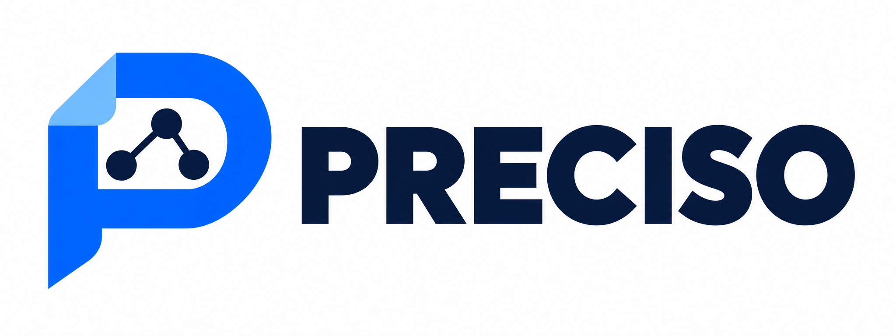

<div align="center">
  <h1></h1>
  <p><strong>Connect your agent to a persistent graph of document evidence.</strong></p>
  <p>Local-first GraphRAG · Model Context Protocol · Reviewed document updates</p>
  <p>
    <a href="https://pypi.org/project/preciso-graphrag/"></a>
    <a href="https://github.com/Preciso-GR/preciso-graphrag/actions/workflows/ci.yml"></a>
    
    <a href="LICENSE"></a>
  </p>
</div>

## What is PRECISO?

PRECISO is a **GraphRAG MCP server for AI agents**. GraphRAG combines graph
connections with retrieval of relevant text. MCP (Model Context Protocol) lets
an agent call the server's tools.

Your agent reads documents and extracts passages, entities, and relationships.
PRECISO validates and stores that extraction. The agent can then retrieve evidence,
follow connections, and maintain the collection across sessions.

```text
Your documents → Agent reads and extracts → PRECISO validates and stores
                                                   ↓
Your question  → Agent queries PRECISO    ← Graph connections + source passages
                         ↓
                Answer with source evidence
```

The agent controls the workflow. PRECISO does not parse raw PDFs, crawl URLs, watch
folders, or continue work after the agent disconnects. It does not require its own
extraction language model. Local embeddings need no embedding API key, but your
agent can still use a cloud model.

**Current release: 0.3.0rc2.** This is a release candidate for individual local
use. Guided setup is verified on macOS with Codex CLI and Claude Code CLI.
See [release notes](https://github.com/Preciso-GR/preciso-graphrag/releases) and
[current limits](#current-limits).

## Who can use it?

PRECISO is intended for people who repeatedly investigate substantial document
collections. The examples below are possible workflows, not validated outcomes
for every domain.

| Audience | A question they could investigate | Starting point |
|---|---|---|
| Financial and business analysts | How did this company's risks and segment performance change across these filings? | A small set of public annual reports; closest to the existing financial evaluations |
| Researchers and research engineers | Which studies support this claim, under which conditions, and where do findings disagree? | Papers with retained source passages and explicit study identifiers |
| Healthcare and life-sciences researchers | How do these studies differ in population, intervention, outcomes, and limitations? | Public research synthesis; patient-care use is not validated |
| Supply-chain and procurement analysts | Which products depend on this supplier, according to these documents? | Domain-specific extraction supplied by the agent; no supply-chain application is included |
| Consultants and diligence teams | Which source supports each conclusion in this assessment? | A reviewed document set for one investigation |
| Legal and compliance professionals | Which documents support this obligation or control? | Exploratory evidence review; requires human verification |
| Product and support teams | Which customer problems relate to this release and its known limitations? | Reviewed exports; source synchronization is manual |
| Developers and maintainers | Why was this design chosen, and which constraints still apply? | Design notes, issue exports, and project documentation |

An analyst using PRECISO inside a company fits the current local workflow.
A shared company knowledge service requires additional authorization, isolation,
and concurrent-access design. PRECISO currently permits **one active runtime per
collection**.

## Quick start

You need **uv**, which supplies `uvx`, **Python 3.11 or later**, and the **Codex CLI
or Claude Code CLI** installed. Start in the project directory that should own the
collection. No repository clone is required.

```sh
uvx --from preciso-graphrag==0.3.0rc2 preciso-graphrag setup --project .
```

The setup wizard will:

1. Ask for **Codex**, **Claude Code**, or **both**.
2. Ask for local or API embeddings.
3. Show required packages and model downloads, then ask before preparing them.
4. Verify the embedding provider and MCP connection.
5. Show each agent connection and ask before registering it. Other entries are preserved.

To preselect both clients:

```sh
uvx --from preciso-graphrag==0.3.0rc2 preciso-graphrag setup --project . --client both
```

Reload your selected agent after setup. Installation alone does not connect every
agent. Codex uses a named entry in its user configuration. Claude Code uses private
project-local registration. **Neither guided flow requires a `.mcp.json` file.**

Both clients use the same project collection. Stop one client's PRECISO runtime
before switching to the other. Also stop active runtimes before rerunning setup's
connection verification.

### Choose embeddings

Embeddings turn text into vectors used to rank related evidence.

| Option | What you need | Behavior |
|---|---|---|
| **Built-in Granite — guided default** | One model download; no Ollama or embedding API key | IBM Granite Small English R2 through FastEmbed, running on CPU |
| **Ollama** | Ollama installed; `nomic-embed-text` or `mxbai-embed-large` | Setup lists supported installed models and can offer a Nomic download |
| **API** | OpenAI or Cohere credentials and network access | Text is sent to the selected provider; usage can incur charges |

If an installed local Ollama service is stopped, setup asks before starting it
and waits for readiness. Setup does not install Ollama. Normal server startup
does not prompt, download weights, or start Ollama.

The built-in English model uses **384-dimensional vectors**. Its pinned artifacts
occupy **188.1 MiB**, plus Python dependencies. Valid cached files are reused.
Inputs above **8,192 model tokens, including special tokens**, are rejected rather
than silently truncated. Tokens are not words. Keep evidence passages focused.

The built-in runtime uses one inference thread and one embedding request at a
time. Existing collections retain their provider and model identity. An unavailable
provider causes an error, not an automatic model switch. Use a new collection or
an explicit rebuild when changing models.

See [guided setup and recovery](docs/simple-setup.md) and
[embedding measurements](docs/embedding-model-selection.md).

## Use it with your agent

Give the agent access to a small, reviewed document set. Start with this prompt:

```text
Use PRECISO for these documents.
Call get_server_status and get_document_workflow first.
Read the authorized source files and follow the returned extraction format.
Keep original evidence passages and cite them from each extracted claim.
Show the document IDs, extraction counts, validation results, and unresolved concerns.
Add the reviewed extractions within this task. Do not silently replace existing documents.
Then answer my question using retrieved evidence. Cite the sources and state
when the evidence is insufficient.
```

Check that the sources are current and belong in the collection. Structural
validation checks the extraction format and references. It cannot prove the
source is true or the extracted claim is correct. PDF reading depends on your
agent's tools or an external conversion step.

For example, start with two annual reports and ask:

> How did the disclosed risks and segment results change between these reports?
> Show the supporting passages and distinguish reported facts from your inference.

Graph retrieval can connect related entities across documents. A retrieved chunk
can still be irrelevant or insufficient. The agent must check the actual passages
before making a claim. PRECISO does not guarantee a correct answer.

## Keep a collection up to date

You can add documents later without starting a new collection. Use stable document
IDs and consistent entity names. Similar names do not automatically prove that two
entities are the same.

| Task | Supported operation |
|---|---|
| Add new documents | Create a new tracked document for each reviewed extraction |
| Retry after an uncertain result | Replay the identical extraction; identical retries are idempotent |
| Correct a document | Replace its complete extraction under the existing document ID |
| Remove a document | Delete its contribution and rebuild from the remaining documents |
| Maintain entities and relations | Inspect, isolate, restore, remove, rename, merge, or disconnect supported records |
| Check supporting text | Read active evidence passages by chunk ID |

Replacement, deletion, and graph edits use a preview followed by a commit with the
returned workspace revision. The revision check rejects stale changes. These
operations rebuild derived stores from the retained document extractions; they
can be expensive for large collections.

Isolation is reversible. Node removal has no restore operation in this version.
Isolation can withhold other claims in the same source passage. Graph edits are
not an access-control boundary or secure erasure. See
[document and graph maintenance](docs/document-lifecycle.md) for exact behavior.

## Main MCP tools

| Tool | Purpose |
|---|---|
| `get_server_status` | Check provider readiness and graph status |
| `get_document_workflow` | Discover the extraction format, operations, and limits |
| `manage_documents` | List, create, preview and apply replacement or deletion |
| `manage_graph` | Inspect, preview and apply supported graph edits |
| `query_graph_tool` | Retrieve context from the collection |
| `read_evidence` | Read active source text for a returned chunk ID |
| `ingest_from_file` / `ingest_graph_tool` | Ingest reviewed file or inline extractions |
| `list_pending_summaries` / `submit_summary` | Let the agent handle deferred description summaries |
| `export_graph_to_neo4j` / `export_vectors_to_qdrant` | Create optional downstream snapshots |

See [MCP operation](docs/mcp-server.md) for the full tool and configuration reference.

## Where data lives

Guided setup uses these macOS defaults:

```text
~/Library/Application Support/PRECISO/projects/<project-path-hash>/
    settings.json     Project settings
    graph/            Graph, vectors, evidence, and contribution ledger

~/Library/Caches/PRECISO/models/    Shared model cache
```

The project also has an extraction input directory beside its settings file.
Use `PRECISO_CONFIG_DIR` and `PRECISO_CACHE_DIR` before setup to select other roots.
API credentials use macOS Keychain or environment variables. They are not written
to project settings or agent command arguments.

Preserve original documents, reviewed extractions, and the **complete graph
directory**. A GraphML file alone is not a full operational backup. Stop the runtime
and follow [backup and recovery](docs/backup-recovery.md).

Neo4j and Qdrant are optional export targets. They are not required for local use
and are not live storage backends. Exported snapshots remain stale until refreshed.

## Docker and other MCP clients

The repository includes a multi-stage **Linux** Docker build. It separates test
and runtime dependencies and runs the server as a non-root user over standard
input/output. No server network port is required.

```sh
git clone https://github.com/Preciso-GR/preciso-graphrag.git
cd preciso-graphrag
docker build --target test -t preciso-graphrag:test .
docker build --target runtime -t preciso-graphrag:local .
```

Follow the [container guide](docs/container-guide.md) to configure a provider,
persistent volume, input mounts, and an MCP client command. The minimal image does
not include the built-in Granite provider or optional cloud/export SDKs. Its Ollama
configuration needs an external Ollama service.

Linux arm64 verification passed 293 tests, lint, summary integrity checks, and an
MCP ingestion/restart/retrieval smoke test. The smoke runtime used one CPU,
512 MiB memory, no network, and fallback embeddings. This verifies protocol and
persistence, not semantic retrieval quality or a production resource budget.

Native Windows containers are not supported by this Dockerfile. Native Windows
Python use also requires changes to POSIX file locking. Linux containers through
Docker Desktop with WSL2 are a possible Windows route; that host setup has not
been verified here.

Other compatible MCP clients can use a manual stdio connection. Client-specific
setup remains manual and unverified. See [manual MCP examples](examples/mcp/README.md).

## Develop and evaluate

For an editable source installation, run these commands from a checkout:

```sh
python3 -m venv .venv
.venv/bin/python -m pip install -e . -r requirements-dev.txt
.venv/bin/python -m pytest -q
.venv/bin/python -m ruff check src tests scripts
```

Source setup, optional provider dependencies, and launch configuration are described
in [getting started](docs/getting-started.md). See [CONTRIBUTING.md](CONTRIBUTING.md)
for required checks and the review workflow.

Historical financial QA results cover a small 23-question evaluation. They do not
establish accuracy for other document sets or the current default embedding model.
See [evaluation methodology](docs/eval-guide.md), the
[retrieval pilot](docs/retrieval-pilot.md), and
[model comparison](docs/embedding-model-selection.md) before interpreting scores.

## Current limits

- Guided setup targets individual macOS users. Windows and Linux automated setup remain unverified.
- One runtime can own a collection. Shared team access and multi-user authorization are not implemented.
- The default embedding model targets English. Retrieval quality needs validation on your own corpus.
- There is no automatic source synchronization, scheduled ingestion, or raw document parser.
- Replacement and graph editing require a complete contribution ledger. Older or incomplete graphs need a rebuild from reviewed extractions.
- Lifecycle rebuilds replay the tracked corpus and can require new agent summaries.
- Healthcare examples concern research documents. Clinical decisions and patient-record workflows are not validated.

See [production readiness](docs/production-readiness.md) for implemented controls
and open release gates.

## Documentation

| Guide | Contents |
|---|---|
| [Guided setup](docs/simple-setup.md) | Agent registration, credentials, model downloads, and recovery |
| [Document preparation](docs/document-preparation.md) | Source review and extraction examples |
| [Document lifecycle](docs/document-lifecycle.md) | Incremental ingestion, replacement, deletion, and graph edits |
| [Architecture](docs/architecture.md) | Modules, storage, and data flow |
| [Container operation](docs/container-guide.md) | Linux image builds and runtime configuration |
| [FAQ](docs/faq.md) | Common issues and correction workflows |
| [Documentation index](docs/README.md) | All guides |

## License

[Apache License 2.0](LICENSE). Named after Bruno Fernandes: every pass should land
where it is needed.
