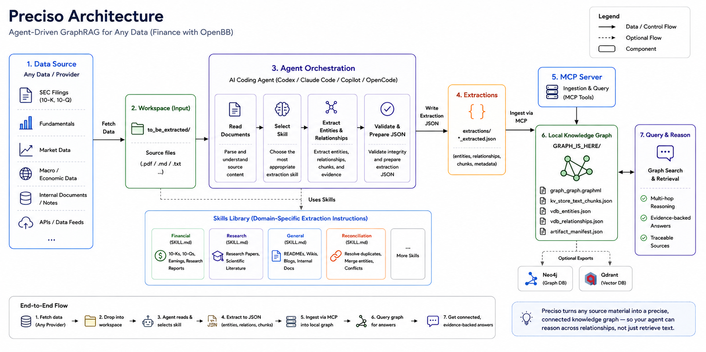
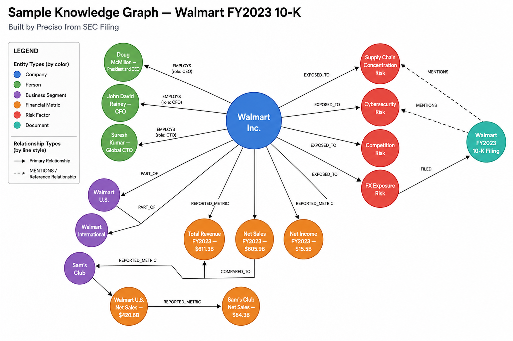

<div align="center">
  <h1>Preciso</h1>
  <p><strong>Precise knowledge graphs from your documents.</strong></p>
  <p><em>Named after Bruno Fernandes. Every pass lands exactly where it needs to.</em></p>
  <p>
    
    
    
    
  </p>
  <p>
    
    
    
  </p>
  <p>
    <a href="https://github.com/Preciso-GR/preciso-graphrag/actions/workflows/ci.yml"></a>
  </p>
</div>

---

Preciso is a **local-first GraphRAG MCP server for agents**. It stores document
passages, entities, and relationships. Your agent can retrieve evidence and follow
connections across documents.

```
Documents → Agent extracts facts → Reviewed extraction → Preciso graph → Evidence for the agent
```

The agent reads the documents, extracts facts, and writes the final answer.
Preciso validates and stores the extraction, retrieves evidence, and manages graph
changes. It does not parse raw PDFs or run an extraction language model itself.
Local embeddings do not require an embedding API key. Your agent's own model may
still use a cloud service.

**Setup version:** **0.3.0rc2**, with Codex and Claude Code registration. See
[PyPI](https://pypi.org/project/preciso-graphrag/) and
[GitHub Releases](https://github.com/Preciso-GR/preciso-graphrag/releases)
for published versions. This is a macOS preview. See the current limitations below.

---

## Why GraphRAG Over Regular RAG?

**Regular RAG:**
```
"What are Apple's risk factors?"
→ returns the Risk Factors section text
```

**Preciso:**
```
"What are Apple's risk factors and which executives are responsible for managing them?"
→ traverses RISK_FACTOR → EXPOSED_TO → COMPANY → EMPLOYS → PERSON
→ returns a connected answer with evidence
```

The graph makes multi-hop reasoning possible.

---

## Benchmark Results

These are historical financial QA results. They do not measure the new Granite
embedding provider. See [model selection](docs/embedding-model-selection.md) for
the separate embedding comparison, test conditions, and limitations.

Tested on 23 financial QA questions from Walmart FY2022 + FY2023 10-K filings, scored on four dimensions:

| Metric             | Score     |
|--------------------|-----------|
| Context Relevancy  | 0.983     |
| Faithfulness       | **1.000** |
| Answer Correctness | 0.960     |
| Precision          | 0.910     |
| **Preciso Score**  | **95 / 100** |

- **Hallucinations:** 0 / 23
- **Failed questions:** 0 / 23

| System                            | Score     |
|-----------------------------------|-----------|
| **Preciso**                       | **95.4%** |
| GPT-4 + long context (79k tokens) | ~79%      |
| GPT-4 + standard RAG              | ~19%      |

See [docs/eval-guide.md](docs/eval-guide.md) for full methodology and multi-hop breakdowns.

---

## Guided Agent Setup — Preview

The automated setup target is **macOS with Codex CLI, Claude Code CLI, or both**.
Preciso requires Python 3.11+. Install uv (which provides `uvx`) and the selected
agent CLI before setup.

Open a terminal in your project directory and run:

```bash
uvx --from preciso-graphrag==0.3.0rc2 preciso-graphrag setup --project .
```

You do not need to clone the repository. uvx installs the package in an isolated
environment. Setup asks before preparing optional provider packages and model files.
For development checkouts and local wheels, see [guided setup](docs/simple-setup.md).

Setup will:

1. Ask whether to connect Codex, Claude Code, or both, then select local or API embeddings.
2. Show required packages and model downloads. If you select an installed but
   stopped local Ollama service, ask before starting it in the background.
3. Verify the selected provider and prepare a separate collection for the project.
4. Test the MCP connection, then show each selected agent entry for confirmation.
5. Preserve other agent entries and reuse an identical existing entry. Ask before
   updating only the package version of a managed entry.

Claude Code registration uses private, project-local scope. Codex registration uses
its named user configuration. Neither requires a `.mcp.json` file. For both clients,
the collection is shared: stop one client's Preciso server before using the other.
Only one runtime can open a collection at a time.

Reload your selected agent after setup. Give it access to your documents and use this prompt:

```text
Call get_server_status and get_document_workflow. Use the returned workflow to
prepare these documents for Preciso. Show the extraction validation summary before
ingestion. Then retrieve evidence from the graph to answer my questions.
```

### Embedding choices

| Choice | What runs | Requirements |
|--------|-----------|--------------|
| Built-in local (default in guided setup) | IBM Granite Small English R2 through FastEmbed | One model download; no Ollama or embedding API key |
| Ollama | An installed `nomic-embed-text` or `mxbai-embed-large` model | Setup can start an installed local service and offer a Nomic download, each after confirmation |
| API | OpenAI or Cohere embeddings | Provider credentials, network access, and possible usage charges |

The built-in English model produces **384-dimensional vectors**. Its pinned model
artifacts total **188.1 MiB**; Python dependencies need additional disk space. Setup
shows the cache path and asks before downloading or repairing model files. Valid
cached files are reused. Normal server startup does not download model weights.

Granite accepts up to **8,192 model tokens, including special tokens**, per input.
Tokens are not words. Preciso rejects longer inputs instead of silently truncating
them. Keep passages focused; split oversized passages or descriptions before retrying.

The built-in provider uses one CPU inference thread and one embedding request at a
time. A saved collection retains its provider and model identity. A failed provider
does not trigger an automatic switch. Changing models requires an explicit new
collection or rebuild.

### Project data and credentials

Guided setup stores each project's settings, graph, and reviewed extractions under
`~/Library/Application Support/PRECISO/projects/<project-path-hash>/`. The model
cache is shared under `~/Library/Caches/PRECISO/models/`. Use `PRECISO_CONFIG_DIR`
and `PRECISO_CACHE_DIR` to select other roots before setup.

API credentials use macOS Keychain or environment variables. They are not written
to project settings or agent command arguments. Codex entries are user-level
settings; separate project collections do not provide access control.

See [guided setup and recovery](docs/simple-setup.md) for credential variables,
download recovery, launcher behavior, and verification limits.

---

## Manual Source Setup

Use this workflow for the repository folders and manual MCP configuration below.
The clone command retrieves the default branch. Most users can use guided setup
above instead of maintaining a source checkout.

### 1. Clone and install

```bash
git clone https://github.com/Preciso-GR/preciso-graphrag
cd preciso-graphrag
python3 -m venv .venv
source .venv/bin/activate
pip install -r requirements.txt
pip install -e .   # register the preciso_mcp/core/ingest packages (editable)
```

> Requires Python 3.11+, a local virtualenv at `.venv`, and the agent opened from the repo root.

### 2. Drop files into `to_be_extracted/`

Best inputs: `.md`, `.txt`, README files, wiki exports, notes.

> For PDFs: convert to `.md` first, or use Claude Code / Codex which can read PDFs natively.

See [document preparation](docs/document-preparation.md) for mechanism 0 and a worked example.
For extraction-only work, keep the MCP server stopped.

### Important: verify your source documents before extraction

Before you ask an agent to process anything in `to_be_extracted/`, check the source documents yourself. Make sure they are factually correct, current, complete, and the exact versions you want represented in the graph. Extraction validation can catch structural problems, but it cannot guarantee that the source document itself is true.

Starting with flawed source data can waste both time and money:

- Extraction may consume paid agent or language-model credits.
- Ingestion generates chunk, entity, and relationship embeddings, which may consume paid embedding-provider credits.
- Flawed evidence can propagate into shared entities, relationships, descriptions, summaries, source links, and embeddings.
- Correcting the mistake later may require regenerating the extraction and rebuilding the entire graph from every valid extraction.

Before starting extraction:

- Remove drafts, duplicates, and superseded document versions.
- Confirm that every remaining document is accurate, final, and belongs in the corpus.
- Preserve the validated source documents so the graph can be reproduced later.
- Start the agent extraction workflow only after you are satisfied with the source corpus.

The agent will perform a second, structural validation of the generated extraction before ingestion. That second check complements—but does not replace—your review of the original data.

If you discover flawed source data after it has entered the graph, follow the [full correction workflow](docs/faq.md#how-do-i-correct-an-already-ingested-document).

### 3. Run this prompt in your agent

Open Codex, Claude Code, Copilot, or OpenCode from the repo root.

**Quick version:**
```
Process the files in to_be_extracted/ using Preciso. Before ingestion, show me
the validation summary and ask me to confirm that the corpus is correct and current.
```

<details>
<summary>Full agent prompt (recommended for first run)</summary>

```
Call get_server_status().
If overall is ready, proceed.
If overall is degraded, explain what is degraded, what still works,
and ask whether to proceed or fix first.
Read the files in to_be_extracted/.
Choose the most appropriate extraction skill from the skills folder for each file.
Extract entities, relationships, and chunks into extractions/{source_name}_extracted.json.
Validate that every source_id maps to a real chunk_id and that all relationships
reference defined entities.
If you find duplicate entities, orphaned relationships, or conflicts,
use the reconciliation skill before ingestion.
Before calling any ingestion tool, summarize the source files, document IDs,
entity/relationship/chunk counts, validation results, and unresolved concerns.
Add new document IDs within the authorized task. Use explicit replacement for
changed tracked documents. If ingestion is outside the authorized scope, obtain
that authorization before persistence. Call ingest_from_file for reviewed files.
Confirm the graph artifacts written to GRAPH_IS_HERE/ and summarize what was ingested.
```

</details>

---

## How It Works



The manual source workflow uses these steps. Guided setup uses the project data
directories described above and exposes its extraction contract through
`get_document_workflow`.

| Step | Who        | What happens                                          |
|------|------------|-------------------------------------------------------|
| 1    | You        | Drop source files into `to_be_extracted/`             |
| 2    | Agent      | Reads the files                                       |
| 3    | Agent      | Selects the right skill from `skills/`                |
| 4    | Agent      | Writes `extractions/{source_name}_extracted.json`     |
| 5    | Agent      | Calls the MCP ingestion tool                          |
| 6    | Preciso    | Persists graph in `GRAPH_IS_HERE/` — queryable immediately |

### Source Checkout Folders

```
src/                ← installed Python application packages
tests/              ← automated tests and manual integrity checks
scripts/            ← launchers, evaluations, and benchmarks
to_be_extracted/    ← drop your source files here (.md, .txt)
skills/             ← agent reads these to know how to extract
extractions/        ← agent writes extraction JSON here
GRAPH_IS_HERE/      ← complete operational graph artifacts
docs/               ← guides and architecture reference
evals/              ← benchmark test cases and results
```

---

## Skill Selection

| Skill | Path | Use When |
|-------|------|----------|
| Financial | `skills/Financial-Graph-Extraction/SKILL.md` | 10-Ks, 10-Qs, earnings calls, analyst reports |
| Research | `skills/Research-paper-graph-extraction-skill/SKILL.md` | Research papers, scientific literature, academic corpora |
| General | `skills/General-graph-extraction-skill/SKILL.md` | Codebases, READMEs, wikis, internal docs |
| Reconciliation | `skills/Reconciliation-Subagent-Skill/SKILL.md` | Cleanup of existing extraction JSON only |
| Eval | `evals/SKILL.md` | Evaluating a built graph — not for extraction |

---

## MCP Tools

| Tool | Description |
|------|-------------|
| `get_server_status` | Runtime health check — call before anything |
| `get_document_workflow` | Get extraction requirements, input limits, and document workflow guidance |
| `manage_documents` | Inspect tracked documents; preview and apply replacement or deletion |
| `manage_graph` | Inspect nodes and edges; preview and apply supported graph edits |
| `read_evidence` | Read active source passages used to support graph facts |
| `ingest_from_file` | Add a new, reviewed extraction to the graph |
| `reingest_from_file` | Replay the identical extraction after an operational failure |
| `ingest_graph_tool` | Add a new, reviewed inline extraction payload |
| `ingest_with_reconciliation_tool` | Ingest after reconciliation subagents finish |
| `ingest_checkpoint_tool` | Process checkpoint-based ingestion |
| `query_graph_tool` | Query the persisted graph |
| `list_pending_summaries` | Agent-handshake mode only: entities/relations deferred for you to summarize |
| `submit_summary` | Agent-handshake mode only: submit your summary for a pending entity/relation |
| `export_graph_to_neo4j` | Optional: push graph structure to Neo4j |
| `export_vectors_to_qdrant` | Optional: push vector artifacts to Qdrant |

### Runtime Status

Always call `get_server_status()` first. It reports embedding mode, graph health, and LLM config before any work starts.

<details>
<summary>Healthy response example</summary>

```json
{
  "overall": "ready",
  "warnings": [],
  "embedding": {
    "mode": "local",
    "provider": "ollama",
    "model": "mxbai-embed-large",
    "dimension": 1024,
    "status": "active"
  },
  "graph": {
    "storage": "networkx",
    "entities": 142,
    "relationships": 281,
    "documents_ingested": 1,
    "chunks": 96
  },
  "llm": {
    "configured": true,
    "status": "active"
  }
}
```

</details>

<details>
<summary>Legacy manual configuration: degraded response example</summary>

```json
{
  "overall": "degraded",
  "warnings": [
    "Fallback embeddings active — graph creation works, vector search quality reduced."
  ],
  "embedding": { "mode": "fallback", "status": "degraded" },
  "llm": { "configured": false, "status": "inactive" }
}
```

Note: `llm.configured: false` is not itself a warning — description compression never
uses an LLM (it's always deferred to the agent via `pending_summaries`, see
`docs/agent-summarization.md`), and query-time answer synthesis just falls back to
raw retrieved context when no LLM is configured.

</details>

Guided setup requires the selected embedding provider to be available. If it is
unavailable, startup fails with a recovery instruction instead of using fallback
embeddings.

If `overall` is `degraded`, the agent explains what still works and asks before proceeding. It never silently continues.

---

## What You Can Query After Ingestion

```
"What are Apple's top 5 disclosed risk factors?"
"Which executives are connected to the supply chain risks?"
"What metrics declined year over year?"
"How does the Services segment relate to overall revenue?"
```

The graph connects entities across document sections so your agent gets reasoned answers, not retrieved chunks.



---

## Graph Artifacts

In the manual source workflow, the graph persists in `GRAPH_IS_HERE/` and is reusable
across sessions. Guided setup uses its project-specific graph directory. Both store
the same operational artifacts:

```
GRAPH_IS_HERE/
├── graph_graph.graphml              ← most portable artifact
├── kv_store_text_chunks.json
├── kv_store_entity_chunks.json
├── kv_store_relation_chunks.json
├── kv_store_pending_summaries.json
├── kv_store_llm_cache.json
├── kv_store_checkpoints.json
├── vdb_entities.json
├── vdb_relationships.json
├── vdb_chunks.json
└── artifact_manifest.json
```

The most portable single artifact is `graph_graph.graphml`, but the complete operational graph includes every file in `GRAPH_IS_HERE/`, especially the vector and evidence stores. Copy the whole folder to move the graph to another machine.

`GRAPH_IS_HERE/` contains operational state, including the contribution ledger
`kv_store_documents.json`. Retain the source documents and reviewed extractions.
Tracked documents support safe replacement and deletion. Older graphs without a
complete ledger require a fresh rebuild. See [document lifecycle](docs/document-lifecycle.md).

---

## Downstream Exports (Optional)

<p>
  
  
</p>

The local graph directory is the operational source of truth. Neo4j and Qdrant are
optional downstream copies, not live storage backends.

```
Local graph (master) → optional → Neo4j copy
Local graph (master) → optional → Qdrant copy
```

Think of it like a Google Doc you export to PDF. The local graph is the operational original and the exports are snapshots for sharing. After additive ingestion or a full rebuild, downstream copies remain stale until you export again.

<details>
<summary>Neo4j export config</summary>

```json
{
  "uri": "bolt://localhost:7687",
  "username": "neo4j",
  "password": "your-password",
  "database": "neo4j",
  "workspace": "default",
  "clear_existing": false
}
```

Required env vars: `GRAPHRAG_NEO4J_URI`, `GRAPHRAG_NEO4J_USERNAME`, `GRAPHRAG_NEO4J_PASSWORD`

</details>

<details>
<summary>Qdrant export config</summary>

```json
{
  "url": "http://localhost:6333",
  "api_key": null,
  "collection_prefix": "preciso",
  "workspace": "default",
  "clear_existing": false
}
```

Required env vars: `GRAPHRAG_QDRANT_URL`, optionally `GRAPHRAG_QDRANT_API_KEY`

</details>

See [docs/getting-started.md](docs/getting-started.md) for full export setup including `.env` configuration.

---

## Manual MCP Setup

Codex and Claude Code users can use guided setup above. It registers the server
through each client's CLI. The manual JSON template is not needed for this flow.

The [manual source example](examples/mcp/README.md) is for compatible clients.
Replace the launcher path with an absolute path before using it. Downloading the
package or copying a configuration file does not automatically connect every agent.

```json
{
  "mcpServers": {
    "graphrag-mcp": {
      "type": "stdio",
      "command": "/bin/sh",
      "args": ["/absolute/path/to/preciso-graphrag/scripts/mcp_launcher.sh"]
    }
  }
}
```

---

## Manual Fallback

For users who want to drive ingestion and querying directly without an agent:

```bash
# Ingest an extraction file
python3 tests/manual/ingest_manual.py extractions/your_file_extracted.json

# Query the graph
python3 tests/manual/query_manual.py "What is Tim Cook's role?" mix

# Run reconciliation demo
python3 tests/manual/reconcile_manual.py
```

---

## Docs

| Guide | What it covers |
|-------|----------------|
| [docs/simple-setup.md](docs/simple-setup.md) | Guided agent setup, project storage, credentials, and recovery |
| [docs/embedding-model-selection.md](docs/embedding-model-selection.md) | Granite selection, measured resource use, and retrieval limitations |
| [docs/domain-model.md](docs/domain-model.md) | Canonical document-lifecycle terminology |
| [docs/getting-started.md](docs/getting-started.md) | Full setup including embeddings and exports |
| [docs/skills-guide.md](docs/skills-guide.md) | How to use and write extraction skills |
| [docs/eval-guide.md](docs/eval-guide.md) | How to run evaluation and read results |
| [docs/architecture.md](docs/architecture.md) | How the system works internally |
| [docs/mcp-server.md](docs/mcp-server.md) | MCP startup, configuration, tools, and recovery |
| [docs/README.md](docs/README.md) | Documentation index |
| [CONTRIBUTING.md](CONTRIBUTING.md) | Development, verification, review, and release workflow |
| [docs/container-guide.md](docs/container-guide.md) | Build and operate the core MCP container |
| [docs/engineering-log.md](docs/engineering-log.md) | Decisions, verification, and documentation method |
| [docs/production-readiness.md](docs/production-readiness.md) | Implemented controls and open release gates |
| [docs/publishing.md](docs/publishing.md) | PyPI account setup, TestPyPI, and release publishing |
| [docs/faq.md](docs/faq.md) | Common problems and fixes |

---

## Current Limitations

- Guided setup is a release-candidate preview; Windows and Linux automated setup is not verified
- The built-in model targets English and rejects inputs beyond its token limit
- Best input format is `.md` or `.txt` — PDF handling depends on external conversion or a native PDF-capable agent
- Retrieval quality depends on embedding configuration
- Document replacement, deletion, and graph edits require a complete contribution ledger and replay the full tracked corpus
- Node isolation can withhold other facts in the same evidence passage; it is not an access-control boundary
- Neo4j and Qdrant exports require those services running externally
- Single-user local workflow — no built-in multi-user or shared graph support yet

---

## License

Licensed under the **Apache License, Version 2.0**. See [LICENSE](LICENSE) for full terms.


The extraction pipeline, skills system, MCP tooling, reconciliation layer, and evaluation framework are original work licensed under Apache 2.0.
